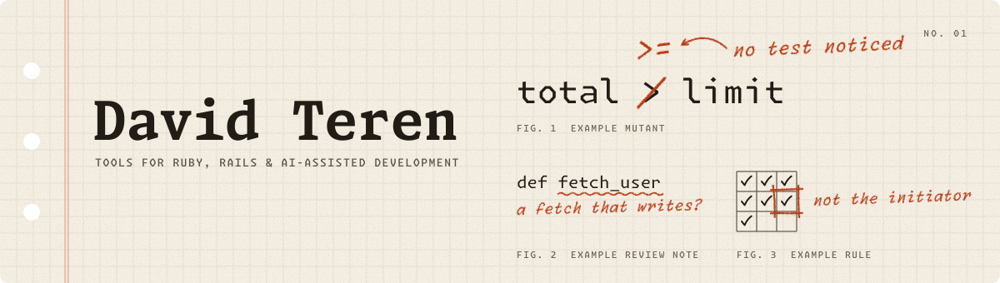

<!--
Maintenance notes (hidden on GitHub):
- Header art: assets/header-light.svg and assets/header-dark.svg, built by assets/header.py.
  The fig. numbers in the art must match the fig. labels on the project headings below.
- When CurrentScope reaches 1.0, remove its `beta` tag and the report-mode sentence.
- When a new flagship appears, revisit "Selected work" and the pinned repositories.
- Before each edit, open every link while logged out.
-->

<picture>
  <source media="(prefers-color-scheme: dark)" srcset="assets/header-dark.svg">
  <source media="(prefers-color-scheme: light)" srcset="assets/header-light.svg">
   limit', the greater-than sign is changed to greater-than-or-equal, with the note 'no test noticed'. Figure 2: the method name fetch_user is underlined, with the note 'a fetch that writes?'. Figure 3: a permission grid has one cell boxed, with the note 'not the initiator'.">
</picture>

I'm David Teren. I build tools for Ruby, Rails, and AI-assisted development, with a focus on clear rules, useful tests, and software that does what you expect.

## Selected work

### Mutineer fig. 1

Mutation testing for Ruby. Mutineer changes your code one small step at a time, runs your Minitest or RSpec suite against each change, and reports every change that no test caught. Its structured results work in CI and give coding agents evidence about test quality.

[Read about Mutineer](https://davidteren.github.io/mutineer/) · [See a sample report](https://davidteren.github.io/mutineer/sample-report.html) · [Source](https://github.com/davidteren/mutineer)

### Intent Engineering fig. 2

A Claude Code plugin that reviews plans, code changes, and whole codebases for surprises. Its lenses check predictability, convention, simplicity, and user experience. On six supported stacks, it also reviews code architecture. Every finding names the expectation that broke and proposes a fix.

[Read about Intent Engineering](https://davidteren.github.io/intent-engineering/) · [Browse published reports](https://davidteren.github.io/intent-engineering/reports.html) · [Source](https://github.com/davidteren/intent-engineering)

### CurrentScope `beta` fig. 3

Authorization for Rails that lives in data you edit, not rules you hard-code. Permissions come from your routes, roles are editable in a UI, and a role can apply to a single record. An optional rule stops whoever started a record from approving it. Trials in report mode are welcome while it is in beta.

[Read about CurrentScope](https://davidteren.github.io/current_scope/) · [Source](https://github.com/davidteren/current_scope)

## Tools for AI-assisted development

- [**dte-skills**](https://davidteren.github.io/dte-skills/): Claude Code workflows that orchestrate other open-source plugins through the review, planning, and delivery of Rails work.
- [**DTE Rails Toolkit**](https://davidteren.github.io/dte-rails-toolkit/): runnable checks for Rails layer boundaries, test smells, N+1 queries, CSV handling, and Action Cable and Turbo Stream security.
- [**Hotwire Codex Skills**](https://davidteren.github.io/hotwire-codex-skills/): an unofficial companion to the book *The Rails and Hotwire Codex*, with skills and checks for web, iOS, and Android.
- [**Rails Security Audit**](https://github.com/davidteren/rails-security-audit): two Claude Code skills for Rails security reviews.

## How I work

I like tools that expose the rule, show the evidence, and stay small enough to understand. Mutineer shows which changes your tests miss. Intent Engineering names the expectation a change breaks. CurrentScope puts access rules where people can read them.

## Elsewhere

I also make small tools for audio workflows, such as [LPX Links](https://davidteren.github.io/lpx_links/), which gathers the download links for Logic Pro, MainStage, and GarageBand sounds, loops, and instruments.

Found a bug or a rough edge? Open an issue on that project's repository. Before a larger change, read the [CurrentScope contributing guide](https://github.com/davidteren/current_scope/blob/main/CONTRIBUTING.md) or the [LPX Links contributing guide](https://github.com/davidteren/lpx_links/blob/main/docs/CONTRIBUTING.md). You can also find me on [LinkedIn](https://www.linkedin.com/in/davidteren/).
